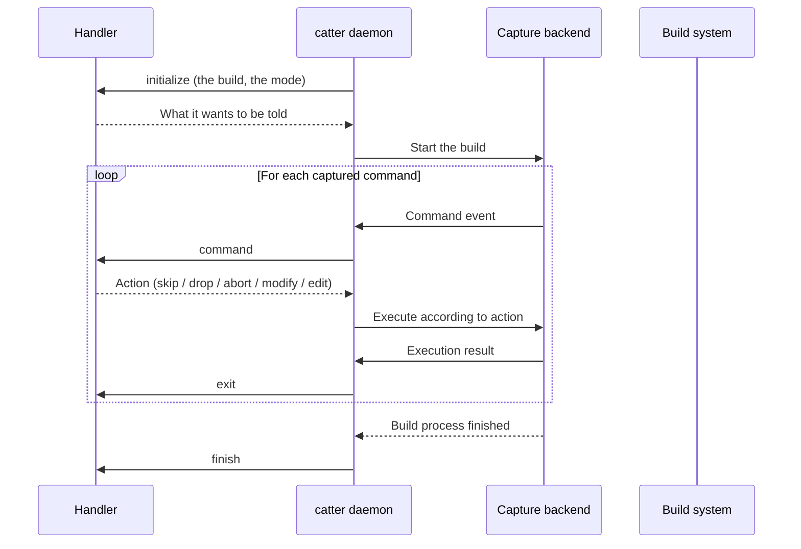

# System Architecture

Catter is a build-process interception and analysis tool organized around **capture backends**. A capture backend is how catter gets a build's commands: every command the build starts becomes an event catter can handle, and is executed according to the decision of the session's handlers -- run as-is, modified, dropped, or aborted.

Handler authors only need to understand two things:

1. **What a capture backend is, and which one the current session uses** -- covered here and in [Capture backends](capture-backends.md).
2. **The lifecycle of a session** -- its start and end at the build level, and each command before and after it runs.

## Capture backends

"Intercepting process creation" differs greatly in feasibility across platforms: a hook in every process of the build is the most general, but some programs keep it out (on macOS, Apple's own tools). Catter therefore separates how a build's commands are captured, a backend, from what is done with them, the session. Each backend starts the build and reports its commands to the session, which has the handlers decide each and tells them how each ended: the handlers see the same events whichever backend reports them.

catter captures a build with the `hook` backend, or with the one `--capture` names: `wrapper`, compiler shims for where the hook cannot reach. Given `--from`, it replays a recorded build instead of running one. A handler learns which from the session's `initialize` message, whose `mode` is the backend's name, or `replay` for a recorded build. What each backend sees and supports is covered in [Capture backends](capture-backends.md).

## Handlers

A session's handlers decide on its commands and are told of its events. They are the built-in the command runs, if any (`compile-commands`, `tree`, `targets`), which runs inside catter, and the [handlers](../scripting/handlers.md) given with `--handler` or `--connect`: programs that catter speaks the [handler protocol](handler-protocol.md) to. The handlers form a chain: the built-in first, then the others in the order of the command line.

## Session lifecycle

### Build level: initialize / finish

**`initialize`** starts the session, before the build: it carries the build command, its working directory and the capture backend. The handler answers with whether it decides on each command, which events it wants to be told, which commands it wants to hear of, and whether commands carry their environment and what catter makes of them.

**`finish`** comes once the build has ended, with the build's exit code. A handler writes its final output here.

### Command level: command / error / exit

**`command`** comes for each captured command before it runs: its working directory, executable, full argument vector, the parent command that started it, and, if the handler asked, its environment and what catter makes of it: the compiler, archiver or tool it runs, and what its arguments say. A handler that decides answers with an action; one that does not is only told, and the build never waits for it.

**`error`** comes instead when catter could not capture a command: the message says why.

**`exit`** comes after each command finishes, with its exit code and how long it took. Handlers can aggregate statistics or failures here.

## Actions: separating handler semantics from execution mechanics

"How to handle a command" is expressed at two layers in catter:

1. **Handler layer** (what handlers decide): `skip` / `drop` / `abort` / `modify` / `edit` -- semantic and independent of the mechanism.
2. **Protocol layer** (what catter-proxy, or on Windows the hook, carries out): `DROP` / `RUN` / `FAIL` -- the concrete execution mechanics.

The session maps handler-layer actions to protocol-layer actions, whichever backend reports the commands:

| Handler action | Semantics                                 | Protocol mapping                                                  |
| -------------- | ----------------------------------------- | ----------------------------------------------------------------- |
| `skip`         | Execute as-is, catter does not intervene  | `RUN` (run with hooks mounted; descendants can still be captured) |
| `drop`         | Do not execute; return exit code 0        | `DROP`                                                            |
| `abort`        | Abort the whole build and report an error | `FAIL` (this command and every later one fail without running)    |
| `modify`       | Execute the command with replacement data | `RUN` (carrying the modified command)                             |
| `edit`         | Execute the command with edited arguments | `RUN` (carrying the edited command)                               |

Keep in mind:

- **`skip` is not "ignore the whole subtree"**. `skip` only lets this command run as-is; its descendants are still captured and still reach the handlers.
- **`abort` ends the session**, as a handler that fails does: the command, and every command the build starts after it, fail without running, and once the build has ended catter prints the reason and exits 1.

## Components and processes

A single catter run involves several processes and components. They are part of the hook and wrapper backends, and handler authors usually do not need to know about them:

| Component           | Role                                                                                                                                                                                          |
| ------------------- | --------------------------------------------------------------------------------------------------------------------------------------------------------------------------------------------- |
| `catter` (daemon)   | Runs the session's handlers, receives commands over IPC and returns decisions                                                                                                                 |
| `catter-proxy`      | Stands in for each command the hook intercepted on Linux and macOS, for each program the wrapper backend has a shim of, and for the build command, which catter starts through it; relays IPC |
| hook shared library | Loaded by the hook backend into every process of the build to intercept process creation; on Windows it asks the daemon itself and starts each program                                        |

They are **implementation details of the backends**; the separation of backends from the session is the center of the architecture. See [Capture backends](capture-backends.md) and [Hook mechanism](hook-mechanism.md).
