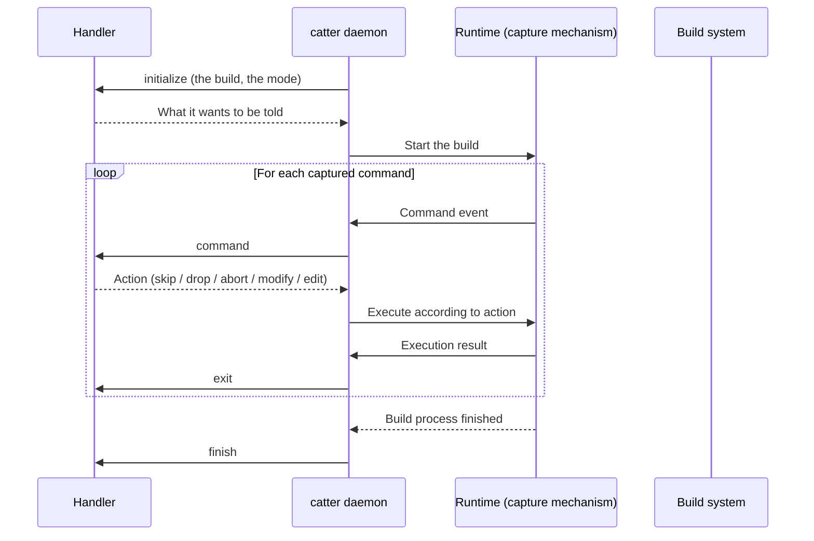

# 系统架构

Catter 是一个围绕 **runtime**（运行机制）展开的构建过程拦截与分析工具。runtime 是实际捕获进程创建行为的机制：构建系统每发起一次命令调用，runtime 负责把它变成 catter 可处理的事件，并按会话中各个 handler 的决定执行——原样执行、修改、丢弃或中止。

handler 作者只需要理解两件事：

1. **runtime 是什么、当前会话用的是哪个** —— 见下文与[运行机制](runtime.md)。
2. **会话的生命周期** —— 构建级的开始与结束，以及每条命令运行前和运行后。

## Runtime 抽象

不同平台对"拦截进程创建"的可行性差异很大：hook 最全能，但在部分平台受限（例如 macOS 需要特殊开发权限）。因此 catter 把捕获机制抽象为 runtime：一个 runtime 就是一种捕获实现；无论是哪一种，handler 看到的都是它捕获的命令。

catter 用 `inject` 捕获构建；指定 `--from` 时，它不运行构建，而是回放一次录制的构建。handler 从会话的 `initialize` 消息得知是哪一种：其中的 `mode` 为 `inject`，或者为 `replay`，表示录制的构建。

目前 `inject`（基于 hook）是唯一的捕获机制，`env` 与 `eslogger` 在计划中。各机制的原理、平台限制与能力差异见[运行机制](runtime.md)。

## Handler

会话中的 handler 对各条命令做决定，并接收会话事件的通知。它们包括命令运行的内置功能（如果有的话；`compile-commands`、`tree`、`targets`），它在 catter 内部运行，以及通过 `--handler` 或 `--connect` 指定的 [handler](../scripting/handlers.md)，即 catter 用 [handler 协议](handler-protocol.md)与之通信的程序。这些 handler 组成一条链：内置功能在前，其余按命令行中的顺序排列。

## 会话生命周期

### 构建级：initialize / finish

**`initialize`** 在构建开始前启动会话：它携带构建命令、构建命令的工作目录和 runtime。handler 在应答中说明它是否对每条命令做决定、想收到哪些事件的通知、想听到哪些命令，以及命令是否携带环境变量和 catter 对它的分析。

**`finish`** 在构建结束后到来，携带构建的退出码。handler 在这里写出最终产物。

### 命令级：command / error / exit

**`command`** 在每条被捕获的命令运行前到来，内容包括命令的工作目录、可执行文件、完整参数、启动它的父命令，以及（handler 要求时）它的环境变量和 catter 对它的分析：它运行的是哪种编译器、归档器或工具，以及它的参数表达了什么。做决定的 handler 以一个动作应答；不做决定的 handler 只接收通知，构建从不等它。

**`error`** 在 catter 未能捕获某条命令时取而代之：消息说明原因。

**`exit`** 在每条命令执行完毕后到来，携带它的退出码和耗时。handler 可在这里做统计与失败聚合。

## Action：handler 语义与执行机制的分层

"如何处理一条命令"在 catter 中分两层表达：

1. **handler 层**（handler 决定的）：`skip` / `drop` / `abort` / `modify` / `edit`，语义化、与机制无关。
2. **协议层**（catter-proxy 执行的，Windows 上则是 hook）：`DROP` / `INJECT` / `FAIL`，是具体的执行机制。

runtime 驱动负责把 handler 层动作映射到协议层动作。当前 `inject` runtime 的映射如下：

| handler 动作 | 语义                         | 协议层映射                                           |
| ------------ | ---------------------------- | ---------------------------------------------------- |
| `skip`       | 原样执行，catter 不干预      | `INJECT`（挂载 hook 执行，子孙命令仍可捕获）         |
| `drop`       | 不执行，直接返回退出码 0     | `DROP`                                               |
| `abort`      | 中止整个构建并报错           | `FAIL`（这条命令及之后的每条命令都不运行，直接失败） |
| `modify`     | 用修改后的命令替换原命令执行 | `INJECT`（携带修改后的命令）                         |
| `edit`       | 用编辑后的参数执行命令       | `INJECT`（携带编辑后的命令）                         |

需要注意的几点：

- **`skip` 不等于"忽略整个子树"**。`skip` 只是让这条命令照常执行；其子孙命令仍会被捕获，也仍会送达各个 handler。
- **`abort` 会结束会话**，与 handler 出错时一样：这条命令以及构建在它之后启动的每条命令都不运行、直接失败；构建结束后，catter 打印原因并以退出码 1 退出。

## 组件与进程

一次 catter 运行会涉及多个进程与组件，它们都属于 runtime 的实现，handler 作者通常无需关心：

| 组件                 | 角色                                                                                                         |
| -------------------- | ------------------------------------------------------------------------------------------------------------ |
| `catter`（守护进程） | 运行会话的各个 handler，通过 IPC 接收命令并返回决策                                                          |
| `catter-proxy`       | 在 Linux 和 macOS 上执行命令并中转 IPC 的可执行文件，分注入模式（启动构建）与包装模式（代替被拦截的命令）    |
| hook 共享库          | inject runtime 的捕获载体，注入构建进程以拦截进程创建调用；在 Windows 上由它自己询问守护进程，并启动每个程序 |

它们是 **inject runtime 的实现细节**，而 runtime 抽象本身才是架构的中心。详见[运行机制](runtime.md)与[钩子机制](hook-mechanism.md)。
